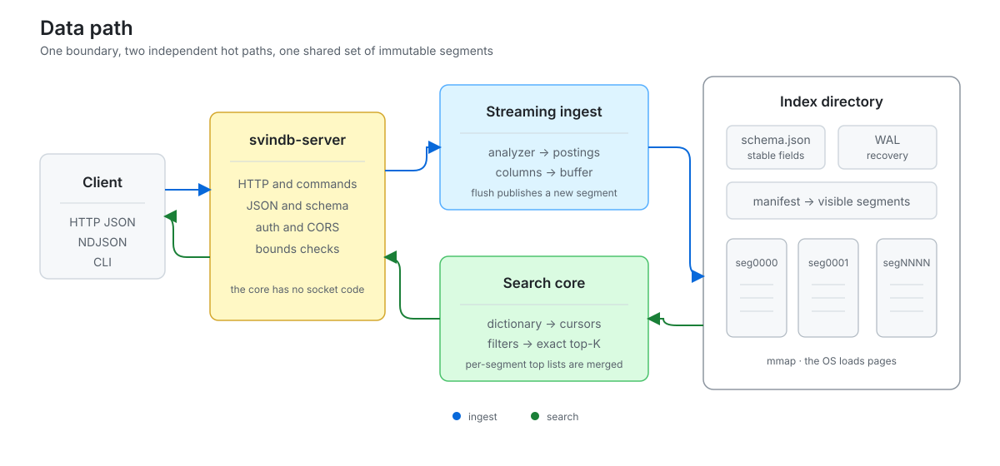
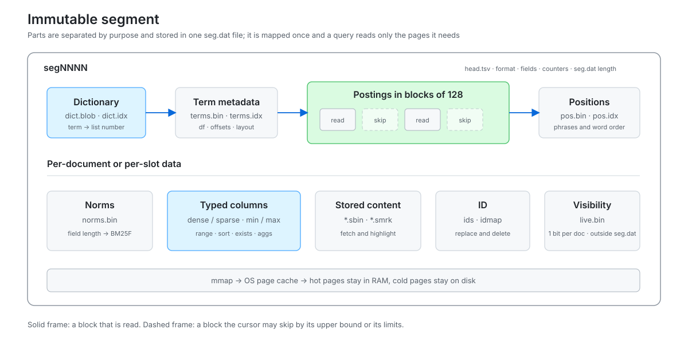
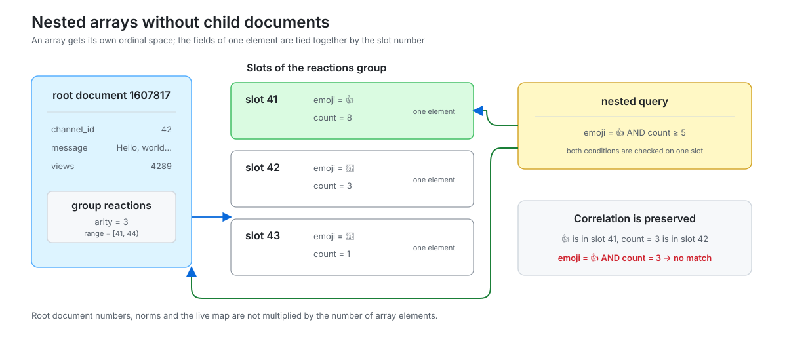

# SvinDB

**English** · [Русский](README.ru.md)

> ## ⚠️ Very early prototype — not ready for real use
>
> SvinDB is a pre-release (`3.0.0-alpha.5`). Its file format, HTTP API and
> defaults can change at any time, and a newer build may not open data written
> by an older one. **Do not keep data in it that you cannot rebuild, and do not
> expose it to the internet.**
>
> It is ready to be **tested**: build it, load a copy of your data, compare it
> with what you use today, and report what breaks. That is exactly what it
> needs right now.

SvinDB is a standalone full-text search and analytics engine written in Rust.
An index is a set of immutable segments in its own file format, read through
memory-mapped files, and served over an HTTP API. The API speaks a practical
subset of the Elasticsearch protocol, so bulk loads and the most common
queries work without being rewritten.

## Contents

- [What it can do](#what-it-can-do)
- [Where it stands today](#where-it-stands-today)
- [Quick start](#quick-start)
- [Elasticsearch compatibility](#elasticsearch-compatibility)
- [How it works](#how-it-works)
- [Command line](#command-line)
- [Security](#security)
- [Known limitations](#known-limitations)
- [Testing](#testing)
- [Contributing](#contributing)
- [Documentation](#documentation)
- [License](#license)

## What it can do

- **Search:** full-text search with BM25 ranking; boolean, phrase and prefix
  queries; exact filters, sorting and deep pagination (`search_after`, point
  in time).
- **Analytics:** exact aggregations (`terms`, `stats`, `histogram`,
  `date_histogram`, `range`, `cardinality`) computed from typed columns.
- **Rich fields:** text, keyword, integers, floats, dates, booleans, geo
  points, binary, dense and sparse vectors, and arrays of objects that keep
  the link between the fields of one element (`nested`).
- **Several independent indices** per process, with aliases, atomic rollover,
  open/close and read/write blocks.
- **Durability:** every acknowledged write is in a checksummed write-ahead log
  (WAL) and survives a crash; the server opens its port only after recovery.
- **Operations:** snapshots and offline restore, integrity checks, live
  settings, a Prometheus-style `/_metrics` endpoint.
- **Access control:** users and API keys with `read` / `write` / `admin` roles;
  TLS through an optional build feature.
- **Scale-out building blocks:** a coordinator that fans a search out to
  shards and merges the answer, and primary-to-replica delivery. There is no
  automatic failover yet (see [limitations](#known-limitations)).
- **Small footprint:** a single binary and no JVM. The core depends only on
  `rayon`; the server adds `serde_json`, and `rustls` for the optional TLS build.

## Improvements in 3.0.0-alpha.5

This release continues the single-node ingest and startup work:

- Encode WAL batches directly from borrowed document cells, avoiding temporary
  document bodies and copied strings. Existing WAL bytes and segment formats stay compatible.
- Reuse checked segment handles during replay and begin ID-directory preparation
  immediately after recovery instead of waiting for the first rescan interval.
- Open and validate compaction outputs before acquiring the writer locks. Reconcile
  late flushes before publication and retain the active memory snapshot by buffer identity.
- Retry failed live-map synchronization physically. A poisoned writer retains WAL
  records and cannot advance its checkpoint before restart.

See [CHANGELOG.md](CHANGELOG.md) for measured changes and validation limits.
This remains a pre-release; the schema and distributed-operation limitations below
still apply. Reproduction tools are included; generated reports and raw results
remain outside the repository and release archives.

## Quick start

You need [Rust](https://rustup.rs); the repository pins the toolchain
(`rust-toolchain.toml`), and `rustup` installs it automatically. Linux and
macOS are supported; Windows is not.

```bash
cargo build --release --locked
./target/release/svindb serve ./data 19300
```

The server listens on `127.0.0.1:19300` only. `./data` is created on first
start.

> **Low disk space?** SvinDB refuses writes when free space falls below the
> larger of 1 GiB and 5% of the volume, and answers `507`. On a small or full
> disk you can lower that reserve, for example `SVINDB_DISK_FLOOR_MB=512`.

Create an index, load a few documents, search:

```bash
# 1. an index with an explicit schema (Elasticsearch-style mapping)
curl -X PUT http://127.0.0.1:19300/articles \
  -H 'Content-Type: application/json' \
  -d '{"mappings":{"dynamic":"strict","properties":{
        "title":{"type":"text"},"body":{"type":"text"},
        "category":{"type":"keyword"},"views":{"type":"long"},
        "published":{"type":"date"}}}}'

# 2. documents in the standard Elasticsearch bulk format
curl -X POST http://127.0.0.1:19300/articles/_bulk \
  -H 'Content-Type: application/x-ndjson' --data-binary @- <<'EOF'
{"index":{"_id":"a1"}}
{"title":"Red fox","body":"quick brown fox jumps","category":"animals","views":10,"published":"2026-01-01T00:00:00Z"}
{"index":{"_id":"a2"}}
{"title":"Lazy dog","body":"quick lazy dog sleeps","category":"animals","views":20,"published":"2026-01-02T00:00:00Z"}
EOF

# 3. make them visible now (otherwise they appear within the refresh interval)
curl -X POST http://127.0.0.1:19300/articles/_flush

# 4. search, with an aggregation
curl -X POST http://127.0.0.1:19300/articles/_search \
  -H 'Content-Type: application/json' \
  -d '{"query":{"match":{"body":"quick"}},"size":5,
       "aggs":{"by_category":{"terms":{"field":"category"}},
               "views":{"stats":{"field":"views"}}}}'

# 5. read one document by id
curl http://127.0.0.1:19300/articles/_doc/a1
```

Every index has its own schema, WAL, segments and settings, so documents from
different indices can never end up in the same file. `GET /_cat/indices` lists
what exists.

SvinDB also has a compact native schema (`"fields":"title:2,body:1,views:int64"`)
and a native query language; both are described in [docs/API.md](docs/API.md).

## Elasticsearch compatibility

SvinDB implements a **subset** of the Elasticsearch HTTP API. The rule it
follows is: *anything it does not understand is an explicit `400` error, never
a silently weaker query.*

| Works | Does not work yet |
|---|---|
| `PUT /{index}` with `mappings`, `settings`, `aliases` | index templates, ingest pipelines, ILM |
| `_bulk` (`index`, `delete`), `PUT/GET/DELETE /_doc/{id}`, `_mget` with `ids` | `create` and `update` bulk actions, `_update`, `_reindex` |
| `match`, `term`, `terms`, `range`, `exists`, `match_all`, one-level `bool`, `nested` | `match_phrase` and `operator` in the Elasticsearch dialect (use the native `phrases`), nested `bool`, `post_filter`, source filtering |
| `size`, `from`, `sort`, `search_after`, `highlight` | `_count`, `_msearch`, `scroll`, `_analyze`, scripting |
| aggregations: `terms`, `stats`, `histogram`, `date_histogram`, `range`, `cardinality` | sub-aggregations, percentiles, `top_hits`, `composite` |
| aliases, rollover, open/close, `_cat/indices`, `_cat/aliases` | field aliases, `ip`, `flattened`, analyzers with stemming or synonyms |

Fields must be declared before they are used; automatic mapping is not
implemented. The exact list, with the reasoning, is in
[docs/SCHEMAS.md](docs/SCHEMAS.md) and [docs/API.md](docs/API.md).

## How it works

An index is a set of **immutable segments**. A dictionary maps terms to
posting lists, block metadata lets a query skip parts of a list, field norms
feed the ranking, and typed columns serve ranges, sorting, `exists` and
aggregations. Read files are mapped into memory with `mmap`.



A write goes to the WAL first, then into a new segment. Background
maintenance merges segments and drops documents that were logically deleted.
Readers work on a snapshot of the segment set and are not blocked by writers.



Arrays of objects get their own slot space: all fields of one array element
share one ordinal, so a condition on two fields is always checked against the
same element, without creating child documents.



More detail is in [docs/ARCHITECTURE.md](docs/ARCHITECTURE.md).

## Command line

```text
svindb serve    [dir] [port] [flags]       run the server
svindb index    <ndjson> <dir> [docs_per_segment] [schema]   build an index offline
svindb merge    <dir> [segments_at_a_time] [doc_limit]        merge segments
svindb snapshot <dir> <target> <name> [--fast]                create a snapshot
svindb restore  <archive> <dir>                               restore into an empty directory
svindb check    <dir> [--full] [--json]                       verify integrity
svindb inspect  <dir> [--deep] [--json]                       show what the space is made of
svindb wal      <dir>                                         inspect the write-ahead log
svindb passwd   [iterations]                                  hash a password for the config
```

Useful `serve` flags: `--read-only` (no writes, no background work),
`--no-maintain` (writes on, background merging off), `--max-indices=N`,
`--config=<file>`, `--tls-cert=` / `--tls-key=`. The full list is in
[docs/API.md](docs/API.md#командная-строка).

## Security

- Authentication turns on as soon as one user is defined in the config file.
  Passwords are stored only as PBKDF2 hashes (`svindb passwd`); failed logins
  are rate-limited per source address.
- `Basic` and `ApiKey` credentials are supported. API keys are random, stored
  as hashes, can expire and can be revoked.
- Roles are global: `read`, `write`, `admin`. There are **no per-index
  permissions yet**.
- TLS is optional and is compiled in with `--features tls`. A binary built
  without it refuses to start if you pass TLS flags, instead of silently
  serving plain text.
- Traffic between a coordinator and its shards, and between a primary and its
  replicas, is **neither encrypted nor authenticated**. Run it only on a
  trusted network.
- Snapshot destinations must be on an allow-list; an empty list forbids them.
- Browser requests from foreign origins cannot modify data.

Found a vulnerability? Please open a private security advisory on GitHub
instead of a public issue.

## Known limitations

- **Unstable.** File format, API and defaults can change; there is no upgrade
  guarantee between pre-releases.
- **Ingest is slow compared with Elasticsearch** (about 3.4× slower on the
  benchmark) and uses a single writer per index.
- **Exact `terms` and `cardinality` aggregations stop at 65,536 distinct
  values** instead of silently approximating.
- **No automatic failover.** Replicas receive operations from the primary, but
  there is no consensus, no election and no online rebalancing. Shard maps and
  terms are set by the operator.
- **Simple HTTP server** (one thread per connection); it is not designed for
  thousands of idle connections.
- **No per-index access control** and no inter-node authentication.
- **Node-wide snapshot/restore** is not available; snapshots are per index.
- **Platforms:** Linux and macOS only.

## Testing

```bash
# unit and integration tests, as in CI
cargo test --workspace --locked --all-features -- --test-threads=1

# lints
cargo clippy --workspace --all-targets --all-features --locked -- -D warnings
cargo fmt --all --check

# Python tooling tests
python3 -m unittest discover -s tools -p 'test_*.py'
```

`tools/` also holds the measurement scripts: `bench_vs_es.py` repeats the
comparison with Elasticsearch, `audit_regressions.py` runs HTTP
regressions against an isolated node, and `fuzz.py`, `corrupt.py` and
`failure_matrix.py` attack the index files and the write path.

## Contributing

**Help is very welcome.** SvinDB is at the stage where outside testers and
contributors matter most, and pull requests are encouraged. You do not need to
be a Rust expert:

- try it on your own data and tell us what worked and what broke;
- report bugs and missing features as issues;
- improve or translate the documentation (the reference docs are still in
  Russian);
- add tests, or take an item from [Known limitations](#known-limitations).

To send a change, fork the repository, make a branch, push it and open a pull
request; the maintainer will review it and merge it. The step-by-step guide,
written for people who have never done this before, is in
[CONTRIBUTING.md](CONTRIBUTING.md).

## Documentation

The reference documentation is currently written in **Russian**; the README
and contribution guide are available in both languages.

- [HTTP API and command line](docs/API.md)
- [Architecture](docs/ARCHITECTURE.md)
- [Schemas and Elasticsearch compatibility](docs/SCHEMAS.md)
- [Release changes](CHANGELOG.md)
- [Contributing guide](CONTRIBUTING.md)

## License

Apache License 2.0, see [LICENSE-APACHE-2.0](LICENSE-APACHE-2.0).

Elasticsearch is a trademark of Elasticsearch B.V. SvinDB is an independent
project and is not affiliated with or endorsed by Elasticsearch B.V.
