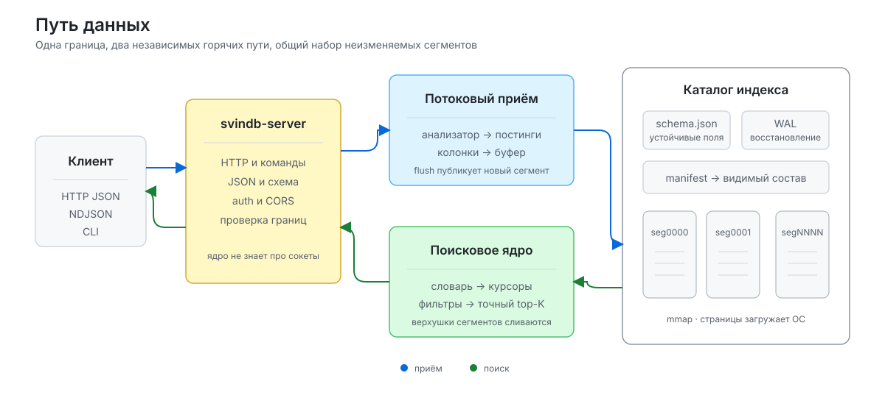
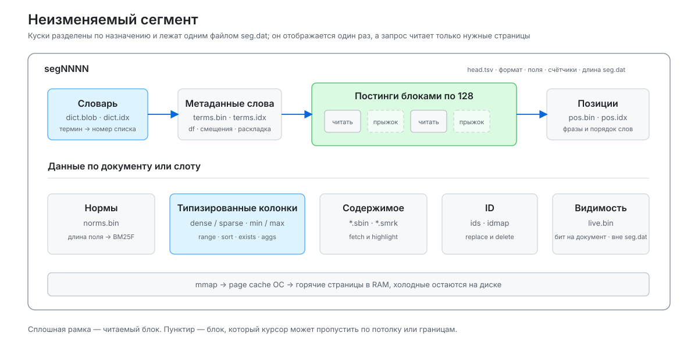
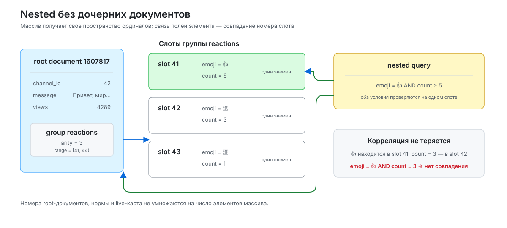

# SvinDB

[English](README.md) · **Русский**

> ## ⚠️ Очень ранний прототип — не готов к реальному использованию
>
> SvinDB — предварительный выпуск (`3.0.0-alpha.5`). Формат файлов, HTTP API и
> настройки по умолчанию могут измениться в любой момент, а новая сборка может
> не открыть данные, записанные старой. **Не храните в нём данные, которые
> нельзя восстановить, и не выставляйте его в интернет.**
>
> Его уже можно **тестировать**: соберите, загрузите копию своих данных,
> сравните с тем, чем пользуетесь сейчас, и сообщите, что сломалось. Именно это
> сейчас и нужно.

SvinDB — автономный движок полнотекстового поиска и аналитики на Rust. Индекс —
это набор неизменяемых сегментов в собственном формате файлов, которые читаются
через отображение в память и обслуживаются по HTTP API. API понимает
практичное подмножество протокола Elasticsearch, поэтому пакетная загрузка и
самые частые запросы работают без переписывания.

## Содержание

- [Что он умеет](#что-он-умеет)
- [Где он сейчас](#где-он-сейчас)
- [Быстрый старт](#быстрый-старт)
- [Совместимость с Elasticsearch](#совместимость-с-elasticsearch)
- [Как это устроено](#как-это-устроено)
- [Командная строка](#командная-строка)
- [Безопасность](#безопасность)
- [Известные ограничения](#известные-ограничения)
- [Тесты](#тесты)
- [Как помочь проекту](#как-помочь-проекту)
- [Документация](#документация)
- [Лицензия](#лицензия)

## Что он умеет

- **Поиск:** полнотекстовый поиск с ранжированием BM25; булевы, фразовые и
  префиксные запросы; точные фильтры, сортировка и глубокая постраничная
  выдача (`search_after`, point in time).
- **Аналитика:** точные агрегации (`terms`, `stats`, `histogram`,
  `date_histogram`, `range`, `cardinality`) по типизированным колонкам.
- **Разнообразные поля:** текст, keyword, целые, дробные, даты, логические,
  географические точки, бинарные данные, плотные и разреженные векторы и
  массивы объектов, где сохраняется связь между полями одного элемента
  (`nested`).
- **Несколько независимых индексов** в одном процессе: алиасы, атомарная
  ротация (rollover), открытие и закрытие, блокировки чтения и записи.
- **Долговечность:** каждая подтверждённая запись лежит в журнале с
  контрольными суммами (WAL) и переживает аварию; сервер открывает порт только
  после восстановления.
- **Эксплуатация:** снимки и офлайн-восстановление, проверка целостности,
  настройки на ходу, конечная точка `/_metrics` в стиле Prometheus.
- **Контроль доступа:** пользователи и API-ключи с ролями `read` / `write` /
  `admin`; TLS через необязательный признак сборки.
- **Заготовки для масштабирования:** координатор, который рассылает поиск по
  шардам и сливает ответ, и доставка операций от primary к репликам.
  Автоматического переключения при отказе пока нет (см.
  [ограничения](#известные-ограничения)).
- **Малый размер:** один бинарник, без JVM. Ядро зависит только от `rayon`;
  сервер добавляет `serde_json` и `rustls` для необязательной сборки с TLS.

## Улучшения в 3.0.0-alpha.5

Продолжена работа над записью и запуском одного узла:

- Пачки WAL кодируются напрямую из ячеек документа, без промежуточных тел
  и копий строк. Байты WAL и форматы сегментов остаются совместимыми.
- Replay переиспользует проверенные сегменты. Подготовка каталога ID начинается
  сразу после восстановления, без ожидания первого интервала пересмотра.
- Результаты слияния открываются и проверяются до захвата замков записи.
  Публикация учитывает поздние flush и сохраняет memory-снимок по идентичности буфера.
- Неудачная синхронизация live-map требует физического повтора. После ошибки
  writer сохраняет WAL и не продвигает checkpoint до перезапуска.

В трёх парных локальных запусках на macOS arm64 с 20 сегментами на индекс
медиана полной готовности снизилась с 655 до 165 мс для одного сброшенного индекса
и с 812 до 367 мс для четырёх. Замер с прогретым кешем включает точный поиск и GET;
устойчивого прироста скорости постоянной записи в этой итерации не установлено.

Замеры и границы проверки — в [CHANGELOG.md](CHANGELOG.md).
Это предварительный выпуск: ограничения схемы и распределённого режима ниже
сохраняются. Инструменты воспроизведения включены; сформированные отчёты и сырые
результаты остаются вне репозитория и архивов выпуска.

## Быстрый старт

Нужен [Rust](https://rustup.rs); репозиторий закрепляет версию инструментов
(`rust-toolchain.toml`), и `rustup` ставит её сам. Поддерживаются Linux и macOS,
Windows — нет.

```bash
cargo build --release --locked
./target/release/svindb serve ./data 19300
```

Сервер слушает только `127.0.0.1:19300`. Каталог `./data` создаётся при первом
запуске.

> **Мало места на диске?** SvinDB отказывается писать, если свободного места
> меньше большего из 1 ГиБ и 5% тома, и отвечает `507`. На маленьком или
> заполненном диске запас можно уменьшить, например
> `SVINDB_DISK_FLOOR_MB=512`.

Создайте индекс, загрузите несколько документов и найдите их:

```bash
# 1. индекс с явной схемой (mapping в стиле Elasticsearch)
curl -X PUT http://127.0.0.1:19300/articles \
  -H 'Content-Type: application/json' \
  -d '{"mappings":{"dynamic":"strict","properties":{
        "title":{"type":"text"},"body":{"type":"text"},
        "category":{"type":"keyword"},"views":{"type":"long"},
        "published":{"type":"date"}}}}'

# 2. документы в стандартном формате пачки Elasticsearch
curl -X POST http://127.0.0.1:19300/articles/_bulk \
  -H 'Content-Type: application/x-ndjson' --data-binary @- <<'EOF'
{"index":{"_id":"a1"}}
{"title":"Red fox","body":"quick brown fox jumps","category":"animals","views":10,"published":"2026-01-01T00:00:00Z"}
{"index":{"_id":"a2"}}
{"title":"Lazy dog","body":"quick lazy dog sleeps","category":"animals","views":20,"published":"2026-01-02T00:00:00Z"}
EOF

# 3. сделать их видимыми сейчас (иначе они появятся в течение интервала обновления)
curl -X POST http://127.0.0.1:19300/articles/_flush

# 4. поиск с агрегацией
curl -X POST http://127.0.0.1:19300/articles/_search \
  -H 'Content-Type: application/json' \
  -d '{"query":{"match":{"body":"quick"}},"size":5,
       "aggs":{"by_category":{"terms":{"field":"category"}},
               "views":{"stats":{"field":"views"}}}}'

# 5. прочитать один документ по id
curl http://127.0.0.1:19300/articles/_doc/a1
```

У каждого индекса своя схема, свой WAL, свои сегменты и настройки, поэтому
документы разных индексов никогда не попадут в один файл. `GET /_cat/indices`
показывает, какие индексы есть.

У SvinDB есть ещё компактная родная схема
(`"fields":"title:2,body:1,views:int64"`) и родной язык запросов; оба описаны в
[docs/API.md](docs/API.md).

## Совместимость с Elasticsearch

SvinDB реализует **подмножество** HTTP API Elasticsearch. Правило такое:
*всё, что он не понимает, — явная ошибка `400`, а не молча ослабленный запрос.*

| Работает | Пока не работает |
|---|---|
| `PUT /{index}` с `mappings`, `settings`, `aliases` | шаблоны индексов, ingest-конвейеры, ILM |
| `_bulk` (`index`, `delete`), `PUT/GET/DELETE /_doc/{id}`, `_mget` с `ids` | действия `create` и `update` в пачке, `_update`, `_reindex` |
| `match`, `term`, `terms`, `range`, `exists`, `match_all`, `bool` одного уровня, `nested` | `match_phrase` и `operator` в диалекте Elasticsearch (используйте родные `phrases`), вложенный `bool`, `post_filter`, фильтрация source |
| `size`, `from`, `sort`, `search_after`, `highlight` | `_count`, `_msearch`, `scroll`, `_analyze`, скрипты |
| агрегации: `terms`, `stats`, `histogram`, `date_histogram`, `range`, `cardinality` | подагрегации, перцентили, `top_hits`, `composite` |
| алиасы, rollover, open/close, `_cat/indices`, `_cat/aliases` | алиасы полей, `ip`, `flattened`, анализаторы со стеммингом и синонимами |

Поля нужно объявлять до использования; автоматическое определение схемы не
реализовано. Точный список и обоснования — в
[docs/SCHEMAS.md](docs/SCHEMAS.md) и [docs/API.md](docs/API.md).

## Как это устроено

Индекс — это набор **неизменяемых сегментов**. Словарь связывает термины со
списками документов, метаданные блоков позволяют запросу пропускать части
списка, нормы полей участвуют в ранжировании, а типизированные колонки
обслуживают диапазоны, сортировку, `exists` и агрегации. Файлы для чтения
отображаются в память через `mmap`.



Запись сначала попадает в WAL, затем в новый сегмент. Фоновое обслуживание
сливает сегменты и убирает логически удалённые документы. Читатели работают со
снимком набора сегментов и не блокируются писателями.



Массивы объектов получают собственное пространство слотов: все поля одного
элемента массива имеют общий ординал, поэтому условие на два поля всегда
проверяется на одном и том же элементе, без создания дочерних документов.



Подробности — в [docs/ARCHITECTURE.md](docs/ARCHITECTURE.md).

## Командная строка

```text
svindb serve    [каталог] [порт] [флаги]     запустить сервер
svindb index    <ndjson> <каталог> [документов_на_сегмент] [схема]   построить индекс офлайн
svindb merge    <каталог> [сегментов_за_раз] [предел_документов]      слить сегменты
svindb snapshot <каталог> <приёмник> <имя> [--fast]                   создать снимок
svindb restore  <архив> <каталог>                                     восстановить в пустой каталог
svindb check    <каталог> [--full] [--json]                           проверить целостность
svindb inspect  <каталог> [--deep] [--json]                           из чего состоит занятое место
svindb wal      <каталог>                                             посмотреть журнал записи
svindb passwd   [повторов]                                            хеш пароля для конфигурации
```

Полезные флаги `serve`: `--read-only` (без записи и фоновой работы),
`--no-maintain` (запись включена, фоновое слияние выключено),
`--max-indices=N`, `--config=<файл>`, `--tls-cert=` / `--tls-key=`. Полный
список — в [docs/API.md](docs/API.md#командная-строка).

## Безопасность

- Проверка доступа включается, как только в файле настроек задан хотя бы один
  пользователь. Пароли хранятся только как PBKDF2-хеши (`svindb passwd`);
  неудачные входы ограничиваются по адресу источника.
- Поддерживаются учётные данные `Basic` и `ApiKey`. API-ключи случайные,
  хранятся как хеши, могут истекать и отзываться.
- Роли глобальные: `read`, `write`, `admin`. **Прав на отдельные индексы пока
  нет.**
- TLS необязателен и включается при сборке признаком `--features tls`.
  Бинарник, собранный без него, откажется стартовать с TLS-флагами, а не будет
  молча отдавать открытый текст.
- Трафик между координатором и шардами, а также между primary и репликами
  **не шифруется и не аутентифицируется**. Используйте его только в доверенной
  сети.
- Приёмники снимков должны входить в разрешающий список; пустой список
  запрещает их.
- Браузерные запросы с чужого источника не могут изменять данные.

Нашли уязвимость? Откройте приватный security advisory на GitHub, а не
публичный issue.

## Известные ограничения

- **Нестабильность.** Формат файлов, API и умолчания могут меняться; гарантий
  обновления между предварительными выпусками нет.
- **Загрузка медленнее, чем у Elasticsearch** (примерно в 3,4 раза на замере) и
  идёт одним писателем на индекс.
- **Точные агрегации `terms` и `cardinality` останавливаются на 65 536
  различных значениях**, а не приближают результат молча.
- **Нет автоматического переключения при отказе.** Реплики получают операции от
  primary, но нет консенсуса, выборов и онлайн-перебалансировки. Карту шардов и
  термы задаёт оператор.
- **Простой HTTP-сервер** (поток на соединение); он не рассчитан на тысячи
  простаивающих соединений.
- **Нет прав доступа на отдельные индексы** и аутентификации между узлами.
- **Снимок и восстановление всего узла** недоступны; снимки делаются по
  индексу.
- **Платформы:** только Linux и macOS.

## Тесты

```bash
# модульные и интеграционные тесты, как в CI
cargo test --workspace --locked --all-features -- --test-threads=1

# проверки стиля и ошибок
cargo clippy --workspace --all-targets --all-features --locked -- -D warnings
cargo fmt --all --check

# тесты Python-инструментов
python3 -m unittest discover -s tools -p 'test_*.py'
```

В `tools/` лежат и измерительные скрипты: `bench_vs_es.py` повторяет сравнение с
Elasticsearch, `audit_regressions.py` запускает HTTP-регрессии на изолированном
узле, а `fuzz.py`, `corrupt.py` и `failure_matrix.py` атакуют файлы индекса и
путь записи.

## Как помочь проекту

**Помощь очень приветствуется.** SvinDB сейчас на той стадии, когда внешние
тестировщики и контрибьюторы нужнее всего, а pull request'ы поощряются. Быть
экспертом по Rust не обязательно:

- попробуйте его на своих данных и расскажите, что сработало, а что сломалось;
- сообщайте об ошибках и недостающих возможностях через issue;
- улучшайте или переводите документацию (справочные документы пока на русском);
- добавляйте тесты или берите пункт из раздела
  [«Известные ограничения»](#известные-ограничения).

Чтобы предложить изменение, сделайте форк репозитория, создайте ветку, отправьте
её и откройте pull request; автор проекта просмотрит его и сольёт. Пошаговая
инструкция для тех, кто никогда этого не делал, — в
[CONTRIBUTING.ru.md](CONTRIBUTING.ru.md).

## Документация

- [HTTP API и командная строка](docs/API.md)
- [Архитектура](docs/ARCHITECTURE.md)
- [Схемы и совместимость с Elasticsearch](docs/SCHEMAS.md)
- [Изменения выпуска](CHANGELOG.md)
- [Как помочь проекту](CONTRIBUTING.ru.md)

## Лицензия

Apache License 2.0, см. [LICENSE-APACHE-2.0](LICENSE-APACHE-2.0).

Elasticsearch — торговая марка Elasticsearch B.V. SvinDB — независимый проект,
не связанный с Elasticsearch B.V. и не одобренный ею.
