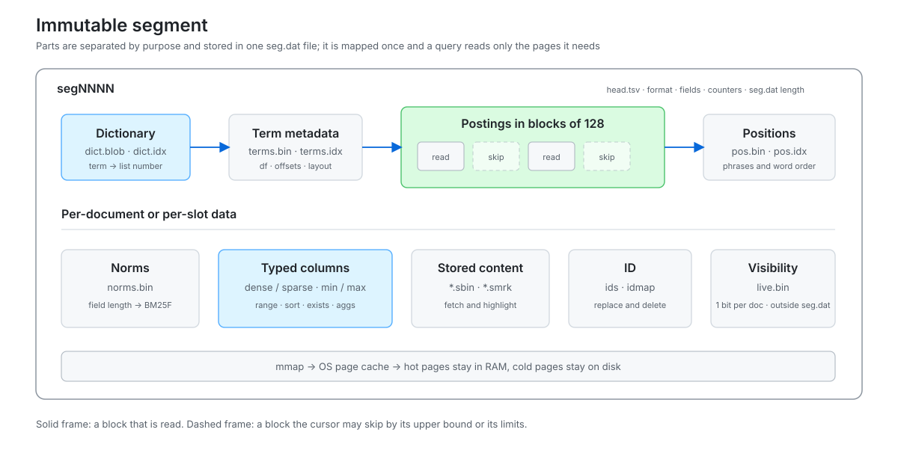
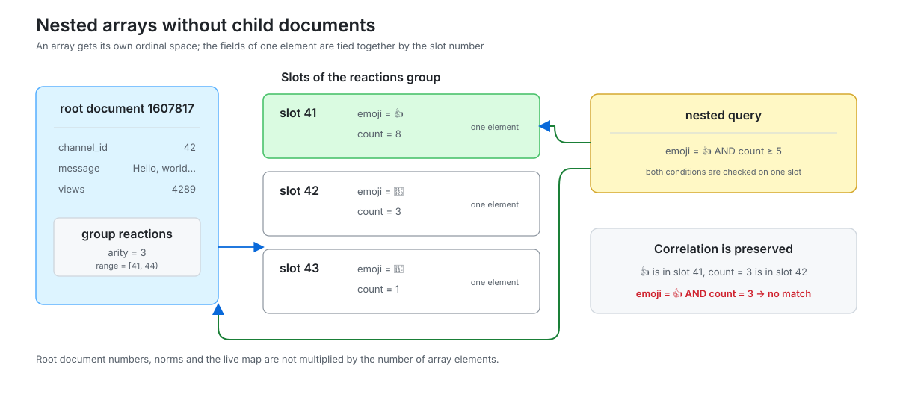

# Архитектура SvinDB

SvinDB — самостоятельный поисковый движок на Rust с неизменяемыми сегментами,
WAL, типизированными колонками и HTTP-сервером. Архитектура рассчитана на
предсказуемое поведение при больших индексах: данные публикуются атомарно,
читатели работают со снимком состава, а повреждение файла превращается в
диагностируемый отказ, а не в молчаливо неверную выдачу.

Публичный контракт описан в [API.md](API.md). Здесь рассматриваются границы
компонентов, форматы хранения и жизненный цикл данных.

## Компоненты

```text
клиент
  │ HTTP/JSON или TLS
  ▼
svindb-server
  ├─ разбор HTTP, лимиты и keep-alive
  ├─ единая маршрутизация и перевод Elasticsearch-диалекта
  ├─ CORS, Basic/API-key и роли
  ├─ типизированный приём вложенных документов и управление настройками
  ├─ координатор шардов и реплик
  ├─ снимки, health и Prometheus metrics
  └─ перевод JSON в запросы ядра
          │
          ▼
svindb-core
  ├─ схема и типы полей
  ├─ индексатор и построение сегментов
  ├─ словарь, постинги, позиции и нормы
  ├─ колонки, хранилище, geo, векторы и slots
  ├─ поиск, фильтры, сортировка и агрегации
  ├─ manifest, mmap, merge/reclaim и checksums
  └─ WAL, snapshot, check и inspect
          │
          ▼
файловая система
```

`svindb-core` не зависит от HTTP, TLS или формата серверной конфигурации.
`svindb-server` не переопределяет формат индекса: он разрешает имена полей по
реестру ядра и передаёт типизированные операции.

## Основные инварианты

1. Опубликованный сегмент неизменяем, кроме карты живых документов.
2. `segments.tsv` заменяется целиком и атомарно.
3. Поиск держит `Arc` на одном снимке состава до завершения запроса.
4. Подтверждённая запись либо находится в опубликованном сегменте, либо
   восстанавливается из WAL. До дисковой публикации она может участвовать в
   поиске через единственный живой сегмент в памяти.
5. Данные и метаданные с диска считаются недоверенными: длины, смещения,
   количества, пути и checksums проверяются до выделения памяти и публикации.
6. Временный файл не становится видимым состоянием. Сначала записываются и
   синхронизируются данные, затем выполняется атомарная подмена.
7. Внутренний номер документа не является устойчивым API-идентификатором.
8. При замене прежняя версия гасится не раньше, чем новая входит в поисковый
   состав. Поэтому подтверждённый `id` не исчезает между ACK и refresh.

## Каталог индекса

```text
index/
├── schema.json          реестр полей и групп
├── settings.json        эксплуатационные настройки индекса
├── segments.tsv         опубликованный состав
├── wal/                 журнал подтверждённых операций
├── .writer.lock         межпроцессный замок писателя
├── .pins/               ссылки живых читателей на каталоги сегментов
├── seg.../              сегмент приёма
├── mrg.../              результат слияния
└── cln.../              результат очистки мёртвых документов
```

Файлы настроек и схемы принадлежат индексу. Аргументы запуска могут временно
перекрывать настройки, но не записывают их обратно.

`segments.tsv` содержит только валидированные имена каталогов. Если файла ещё
нет, ядро может восстановить начальный состав сканированием законченных
сегментов. Дубликаты, traversal, symlink вместо каталога и сегмент без
`head.tsv` отвергаются.

## Корень нескольких индексов

Для нового каталога это верхний уровень по умолчанию: каждый дочерний каталог
остаётся полноценным обычным индексом с теми же форматами и инвариантами.
Маршрутизатор выбирает одну ссылку `Arc<Node>`, внутри которой вместе живут
`Segments`, `Writer`, WAL, schema/settings и метрики. Поэтому невозможно
сочетать сегменты одного индекса с writer другого даже при конкурентном
DELETE/CREATE.

Создание проходит через `.creating`: metadata, schema и settings полностью
записываются и синхронизируются, затем каталог одним `rename` публикуется в
`indices/`, после чего открывается runtime. Удаление делает обратное: имя
исчезает из процессного реестра, завершившиеся запросы отпускают `Arc`, фоновые
refresh/rescan/merge останавливаются, writer-lock закрывается, и только после
этого каталог атомарно переносится в `.trash` и удаляется. После падения
неопубликованный staging и trash дочищаются; опубликованный каталог либо цел и
открывается, либо весь процесс отказывает с именем повреждённого индекса.

У root есть отдельный межпроцессный writer-lock. Замки дочерних индексов не
заменяют его: два процесса на пустом root иначе могли бы одновременно создать
разные имена и оба считать себя владельцем lifecycle.

Логический состав root хранится отдельно от листинга `indices/` в
`catalog/snapshot.bin` и `catalog/journal.bin`. Snapshot содержит физические
UUID, состояния, blocks, metadata и aliases на одном generation; журнал —
малые checksum-framed транзакции после него. Новый `Arc<Catalog>` публикуется
только после append+fsync. Поэтому один запрос всегда видит согласованные
alias targets и write block одного поколения, а rollover не имеет промежутка с
двумя writers. Crash-tail последней записи можно отбросить; checksum-разрыв в
середине, missing catalog у format 2 и неизвестный record kind останавливают
запуск fail-closed.

Закрытый индекс остаётся записью catalog без `Node`: нет writer, WAL runtime,
фоновых потоков и mmap. `/_open` сначала выполняет recovery и лишь затем
прикрепляет Node. `--max-indices` поэтому считает открытые runtime, а не число
архивных поколений на диске.

Ресурсы, которые принадлежат процессу, не размножаются на число индексов:

- HTTP body-budget и query memory pool общие;
- автоматическая доля ingest RAM делится между открытыми writer'ами, явные
  `flush_mb` сначала вычитаются из общего бюджета;
- eager warm проходит индексы последовательно с одним лимитом байт и времени;
- тяжёлый merge допускается только в одной процессной полосе;
- `--max-indices` ограничивает открытые фоновые потоки, файловые дескрипторы и
mmap управляемым операторским числом.

До открытия runtime корень классифицируется без записи: отсутствующий/пустой
становится multi-index, marker и его безопасно распознаваемый crash-tail ведут
в multi recovery, прочий непустой каталог считается legacy-index. Наличие
служебных `indices/.creating/.trash/catalog` без marker тоже ведёт в fail-closed
multi-проверку, а не в старый writer: повреждённый multi-root нельзя случайно
загрязнить файлами одноиндексного формата. `--single-index` переопределяет
только новый или уже legacy-каталог; на опубликованном multi-root он получает
отказ.

## Схема

`schema.json` хранит устойчивые числовые идентификаторы полей и групп. Поле
имеет путь, тип, boost, признаки `store` и `index`, версию появления и, при
эволюции, версию удаления.

Основные классы:

- `text` — анализируется на слова и ранжируется;
- `keyword` — индексируется целиком;
- числовые, `date`, `date:iso` и `bool` — хранятся в колонках;
- `binary` — индексируется точным Base64-представлением, а хранится байтами;
- `geo_point` — хранит исходную точку и две числовые колонки широты/долготы;
- `dense_vector` — отдельная кодированная векторная структура;
- `sparse_vector` — измерения представлены как взвешенные термы;
- группы slots — сохраняют принадлежность значений одному элементу массива.

Схема эволюционирует добавлением новых устойчивых номеров. Сегменты разных
версий могут находиться в одном индексе, если их определения совместимы.
Изменение типа живого поля отвергается.

## Сегмент

Сегмент — завершённая неизменяемая единица поиска. Логически он содержит:

- словари термов;
- списки документов, частоты и блоковые верхние границы;
- позиции слов;
- нормы полей;
- типизированные колонки и индексы диапазонов;
- внешние идентификаторы и Bloom-фильтр;
- сохранённое содержимое;
- плотные и разреженные векторы;
- arity/ordinal структуры вложенных массивов;
- checksums и метаданные формата.



### Файлы сегмента

Новый упакованный сегмент содержит четыре файла:

| Файл | Назначение |
|---|---|
| `head.tsv` | версия раскладки, схема, счётчики и ссылка на контейнер |
| `seg.dat` | контейнер всех неизменяемых частей |
| `live.bin` | изменяемая карта живых документов |
| `sums.tsv` | сводка checksums, публикуемая последней |

Старые рассыпанные сегменты продолжают читаться. `pack` и `unpack` меняют
физическую упаковку без изменения логического содержимого.

### Контейнер `seg.dat`

Контейнер уменьшает число mmap-областей: независимо от числа полей все
неизменяемые части используют одно отображение. `live.bin` остаётся отдельным
из-за атомарных изменений и синхронизации малой области.

Формат контейнера:

```text
64-байтный header
выровненные по 64 байтам members
отсортированный TOC, 96 байт на member
32-байтный trailer
```

Header и trailer независимо содержат границы TOC, длину файла и checksum TOC.
Читатель проверяет:

- magic и версию контейнера;
- точную длину файла;
- согласованность header/trailer;
- допустимое число members;
- UTF-8 и допустимость имён;
- сортировку и уникальность TOC;
- отсутствие наложений, выходов за файл и арифметических переполнений;
- checksum TOC.

CRC каждого member хранится в TOC. Проверять все members при каждом открытии
слишком дорого; их полный пересчёт выполняет `check --full`.

Header с magic записывается последним. Поэтому оборванная запись контейнера не
может выглядеть опубликованной. `head.tsv` начинает ссылаться на `seg.dat`
только после завершения контейнера.

### Карта живых документов

Удаление не переписывает постинги. В `live.bin` атомарно сбрасывается бит
документа. Файл содержит magic, поколение и checksum; чтение использует схему,
подобную seqlock, чтобы отличить согласованный снимок от параллельного
изменения.

Мёртвые документы перестают участвовать в поиске немедленно. Диск освобождается
при reclaim, который строит новый сегмент только из живых документов.

### Нумерация

Локальный номер внутри сегмента — `u32`. Общий номер в снимке состава — `u64`,
но ограничен `2^53 - 1`, чтобы JSON-клиенты на JavaScript не теряли точность.

Слияние меняет общие номера. Для долговременной адресации используются внешние
строковые `id`; в распределённом запросе внутренний адрес — пара
`(shard, doc)`.

## Чтение и mmap

Неизменяемые файлы открываются read-only и отображаются в память. Контейнер
предоставляет `Region`: диапазон внутри общего `Mapped`, удерживающий исходное
отображение через совместное владение.

Это даёт три свойства:

- нет копирования больших массивов при открытии;
- ядро ОС управляет page cache;
- старый снимок остаётся валиден после публикации нового состава.

SvinDB отдельно считает число живых mappings и читает системный предел. Для
упакованного сегмента обычно нужны две области: `seg.dat` и `live.bin`.
Недостаток `vm.max_map_count` диагностируется отдельно от нехватки памяти.

Сегменты открываются лениво: метаданные состава можно прочитать без mmap всех
данных, а сегмент, которого запрос не касается, не создаёт отображения.

## Путь записи

```text
HTTP/NDJSON
  → единый разбор маршрута и диалекта тела
  → обход вложенного документа по schema.json
  → построение скаляров и slot-групп
  → strict-решение: batch, document или report
  → последовательность WAL
  → fsync группы ожидающих операций
  → буфер Indexer
  ├→ refresh: полная пересборка одного живого сегмента в памяти
  │            без изменения segments.tsv и checkpoint
  └→ flush: построение временного сегмента на диске
             → fsync файлов и каталога
             → атомарная публикация segments.tsv
             → применение отложенных гашений прежних версий
             → checkpoint и удаление закрытых WAL-файлов
```

### WAL

Записи WAL имеют длину, sequence number, тип операции, тело и CRC. Поддержаны
`ADD`, `PUT`, `DELETE` и записи документов со slot-группами. Плоский документ
сохраняет прежний формат записи. Журнал разбит на файлы; очередной файл
открывается без перехода по symlink и имеет верхнюю границу размера.

Ответ операции возвращается после долговечной фиксации WAL. Первый ожидающий
commit оставляет короткое настраиваемое окно, в которое соседние запросы могут
попасть под тот же `fsync`; каждый ACK всё равно ждёт собственного durable
рубежа. Много-документный запрос записывается одной внешней WAL-записью с общей
CRC, поэтому queue item, attempt и checkpoint при обрыве хвоста остаются целой
единицей replay. После публикации сегмента checkpoint атомарно сдвигается;
закрытые файлы до checkpoint удаляются целиком.

При старте replay:

- проверяет порядок sequence numbers и CRC;
- останавливается на первой повреждённой или оборванной записи;
- не применяет записи до checkpoint;
- до открытия порта доводит последний восстановленный mutable-хвост через
  обычный flush/publish; узел либо сразу отдаёт весь подтверждённый состав,
  либо не становится ready;
- сообщает число replayed-операций и отброшенных байтов через `/_health`.

Последний пункт про публикацию — часть correctness, а не задержка ради
прогрева. Без него быстрый клиент после restart успевал обогнать первый
`refresh_interval_ms`: WAL уже восстановил подтверждённую пачку в память, но
первый поиск видел только прежние дисковые сегменты. В release-сборке это окно
воспроизводилось стабильно. Поэтому readiness включает запись хвоста, публикацию
сегмента, синхронизацию карт живости и продвижение checkpoint независимо от
размера хвоста.

`--no-wal` отключает эту гарантию и предназначен только для воспроизводимого
повторного импорта.

### Буфер, живой сегмент и сброс

Долговечность, поисковая видимость и дисковая публикация — три разные границы.
ACK следует после WAL `fsync`. На каждом `refresh_interval_ms` из текущего
буфера может быть целиком собран один живой сегмент в памяти. Он входит в
`Arc<Segments>` наравне с дисковыми, но не записывается в `segments.tsv`, не
сдвигает checkpoint и не участвует в merge/reclaim.

`live_max_docs` ограничивает цену полной пересборки. Пока буфер не больше этого
порога, редкая запись становится видна поиску через refresh без создания
мелкого дискового сегмента. Выше порога живой сегмент не строится: массовая
загрузка сохраняет пропускную способность, а видимость приходит с обычным
flush. Ноль отключает механизм полностью.

Дисковый сегмент строится, когда достигается один из независимых порогов:

- `flush_docs` — число документов;
- `flush_mb` — оценка занятой памяти;
- `refresh_interval_ms` — период обновления живого сегмента и проверки буфера;
- `refresh_min_docs` — достаточно ли документов для обычной временной
  публикации;
- `refresh_max_interval_ms` — жёсткий возраст малой пачки.

Таким образом, durable ACK и поисковая видимость разделены, но высокая
`refresh_min_docs` больше не делает малую пачку невидимой. Жёсткий возраст
гарантирует eventual дисковую публикацию и движение WAL checkpoint. `/_flush`
запускает её явно и ждёт ограниченное время, не удерживая общий ingest-lock на
всём дисковом проходе.

Документы буфера, уже отданного фоновому писателю, остаются представлены его
живым сегментом до посадки дискового преемника. Отложенные гашения привязаны к
имени этого преемника: порядок сегментов не используется как признак свежести,
поскольку merge может поставить результат на место первого источника.

Порог памяти учитывает доступную процессу память и cgroup. После фоновой записи
буфер возвращается индексатору; его большая временная ёмкость не становится
постоянным baseline процесса.

На входе писателя стоит ограниченная очередь. Переполнение даёт retryable 429
до разбора тела и ожидания внутренних замков, поэтому медленный flush не
превращается в неограниченную очередь потоков. Писатель процесса допускается
один. `.writer.lock` связывается с процессом-владельцем;
осиротевший замок можно безопасно забрать после проверки владельца.

Отдельный общий permit ограничивает сырые HTTP-тела: не более 128 МиБ и не
более 1/32 памяти, фактически доступной процессу с учётом cgroup. Сырое тело —
только первая копия: JSON-разбор и индексатор кратковременно усиливают расход,
поэтому фиксированные 128 МиБ небезопасны в маленьком контейнере. Насыщение
возвращает retryable `429` до аллокации тела. Сервер затем потоково дочитывает
его малым буфером и закрывает соединение, чтобы клиент получил именно ответ, а
не `Broken pipe` с неопределённым статусом операции.

## Публикация состава

Новый сегмент полностью строится в отдельном каталоге. Перед публикацией
писатель проверяет полосы арности (`одна запись на документ`), затем открывает
готовый каталог тем же production-разбором, которым пользуется поиск. Только
после успешного открытия и синхронизации `segments.tsv` заменяется атомарно.
Поэтому manifest не может назвать сегмент, обязательные куски или размеры
которого не принимает сам движок; WAL такого сброса остаётся непогашенным.

Живой сервер хранит `Arc<Segments>` за `RwLock`. Поток reload сравнивает состав
и переиспользует объекты неизменившихся сегментов. Если перечитывание не
удалось, сервер продолжает отвечать по последнему цельному снимку, увеличивает
`reload_failures` и выставляет `ok:false`. Новые записи в этот момент не
подтверждаются: дальнейший ACK наращивал бы разрыв между durable-приёмом и
поисковой видимостью. Фоновый пересмотр продолжает работать и автоматически
снимает backpressure после первого успешного открытия. Повторяющаяся причина
пишется в журнал на первом отказе и степенях двойки; точное число всегда видно
в `/_health` и `/_metrics`, поэтому постоянная ошибка не создаёт log storm.

Живой сегмент хранит те же словари, postings, колонки, slots и stored fields,
что дисковый, но его `SegmentSource` состоит из областей памяти, а не mmap.
Публикация обновлённого живого сегмента заменяет предыдущий одним движением.
Посадка на диск тем же движением добавляет преемника, снимает соответствующий
живой сегмент и только затем гасит замещённые версии в остальных сегментах.

Точечное `GET /_doc/{id}` и пакетное `/_mget` берут замок буфера раньше снимка
состава. Этот порядок совпадает с писателем и не допускает окна, в котором
документ уже вынут из буфера, но ещё отсутствует в снятом читателем составе.

Удалять старый каталог сразу нельзя: другой процесс или прежний снимок может
ещё читать его. Pins и `grace_ms` отделяют логическое исключение из состава от
физического удаления.

## Поиск

```text
JSON
  → определение родного или Elasticsearch-диалекта
  → перевод в один внутренний JSON-контракт
  → разрешение полей и проверка схемы
  → раскрытие термов/префиксов
  → оценка memory breaker
  → выбор затронутых дисковых и живого сегментов
  → параллельный обход
  → глобальный top-k
  → пакетное извлечение полей
  → JSON
```

### Текстовый обход

Движок использует два основных режима:

- MaxScore для запросов только из необязательных слов;
- булев обход для `must`, `must_not`, фильтров, фраз, сортировки и вложенных
  условий.

Постинги разбиты на блоки. Метаданные блока содержат верхнюю границу вклада;
если она не способна превысить текущий порог top-k, блок пропускается.

В булевом запросе ведущим становится селективное обязательное условие.
Остальные курсоры переходят к его текущему документу, поэтому конъюнкция не
обязана последовательно проходить самый частый список.

Порог `k`-го результата передаётся между сегментами. Новый сегмент начинает
отсечение с уже известного порога, а не набирает независимую верхушку с нуля.

### Параллелизм

Лимит `--threads` задаёт максимум одного запроса. Фактическая доля вычисляется
по числу ядер и текущих запросов: одиночный тяжёлый запрос может использовать
все разрешённые ядра, конкурентные запросы делят их.

Сегменты являются естественными единицами параллелизма. Для одного большого
сегмента отдельные поисковые пути умеют делить работу внутри сегмента. Scan-based
агрегация выполняется как набор document ranges, если
полосы достаточно велики и промежуточное состояние сливается точно. Float sum,
word/phrase/must-not cursor, selective column leader и bucket-header fast path
остаются целой работой. Один atomic guard принадлежит всему запросу, поэтому
deadline/cancel не умножается на число полос и неполнота не скрывается.

Numeric/keyword buckets используют integer mixer со случайным seed отдельной
карты: пользователь управляет значениями колонки, но не знает hash layout.
Packed column читает до 64 значащих бит из одного 128-битного little-endian
слова; у конца mmap остаётся bounded побайтовая ветвь без чтения за границей.

### Memory breaker

До начала поиска оценивается память верхушки, условий, агрегаций и
сегмент-зависимых структур. Превышение `memory_budget_mb` возвращает `429` и не
начинает частичную работу. Это защищает процесс от корректного, но слишком
дорогого запроса.

### Выдача содержимого

После top-k ядро группирует документы страницы по сегментам и кускам
хранилища. Поля и lossless source извлекаются пакетом с ограниченным байтовым
кешем, чтобы глубокая страница не распаковывала один кусок дважды и
одновременно не держала в памяти весь source.

У обычного нового индекса исходный JSON хранится в одном скрытом stored-поле.
Поэтому проекцию `fields` можно получить и для листа с `store:false`, не
дублируя сотни разреженных полей отдельными store-колонками. Legacy-сегмент и
индекс с `source.mode=disabled` могут вернуть только явные `store:true` поля.
Недоступное значение отсутствует в `fields`, а не подменяется пустой строкой.
Подсветка выполняется только для итоговой страницы; без source она требует
отдельно сохранённый текст.

### Атомарная версия документа

Приём строит три представления одной логической версии:

1. исходный JSON `_source` без flattening;
2. необязательную отдельную проекцию `fields`, если клиент прислал её явно;
3. typed cells для postings, columns, vectors и nested slots.

Они находятся в одном документе Indexer, одной WAL-записи и одном сегменте.
ACK, replay, merge, replace/delete и публикация не могут подтвердить source без
индексной проекции или наоборот. Отсутствие значения выражается отсутствием
cell и ключа в source; пустая строка получает отдельный exact term, `null`
остаётся только в source.

Source mode — статическая часть mapping. В режиме `stored` внутренние поля
`__svindb_source` и `__svindb_projection` входят в schema и обеспечивают
описанный атомарный контракт. В режиме `disabled` они вообще не объявляются:
входной JSON валидируется и раскладывается в typed cells, после чего исходные
байты отбрасываются. `mapping.json` хранит выбор, поэтому restart, rollover и
snapshot/restore не могут самопроизвольно вернуть source. Живое переключение
режима запрещено, чтобы сегменты одного индекса не расходились по способности
восстановить документ.

Массив скаляров передаётся индексатору length-prefixed кодом без
пользовательского разделителя. Каждое значение получает posting, а наружу код
никогда не выходит. Это устраняет коллизию между одним значением с `U+001F` и
несколькими элементами.

### Векторы

Плотные векторы квантуются и хранят собственную структуру поиска. Векторное
поле не дублируется в stored fields. Разреженный вектор использует словарь и
постинги, но передаёт явный вес измерения вместо BM25-вклада.

## Вложенные массивы



Для каждой группы массивов хранится arity корневого документа. Префиксная сумма
задаёт непрерывный диапазон ordinals элементов. Значения полей одного элемента
имеют общий ordinal.

`slots` сначала пересекает условия в пространстве элементов, затем переводит
совпавшие ordinals обратно в корневые документы. Поэтому условия `emoji=👍` и
`count>=10` не могут случайно совпасть на разных элементах одного массива.

Для nested-внутри-nested каждый путь имеет собственную группу. Прямой запрос к
внутреннему пути остаётся точным по его элементу. Запрос, который одновременно
связывает родителя и ребёнка, сначала получает bounded coarse-пересечение
групп, затем проверяет parent-child структуру по lossless source. Если число
кандидатов превышает breaker, узел отвечает `429`, а не отбрасывает хвост.

При слиянии ordinals перенумеровываются, а arity и значения переносятся одним
потоком. Агрегация с `over` считает элементы, обычная агрегация — документы.

Приём обходит документ по зарегистрированным путям, а не по произвольным ключам
входного JSON. Это не позволяет неизвестному полю самовольно расширить схему.
Плоский быстрый путь отключается для схем со slot-группами даже у документа с
одним элементом: иначе arity не попала бы в сегмент и WAL replay воспроизвёл бы
другую структуру.

План обхода и функция укладки общие для HTTP-приёма и `svindb index`. CLI не
ищет буквальный ключ `reactions.emoji` в корне JSON: он спускается в объект и
формирует те же cells/ordinals, что сетевой путь. Это обеспечивает одинаковую
семантику после merge, restart и snapshot/restore независимо от способа
первичной заливки.

## Фоновое обслуживание

Обычный `serve` запускает два независимых процесса:

- merge уменьшает число сегментов;
- reclaim удаляет физические данные логически мёртвых документов.

`--no-maintain` отключает оба, сохраняя чтение и запись. `--read-only`
отключает также писателя и WAL.

### Tiered merge policy

Сегменты группируются по размеру, а не только по числу документов. Малые
сегменты поднимаются по ярусам; `floor_mb` не даёт очень мелким сегментам
сливаться неэффективными парами. `per_tier` определяет допустимое давление, а
`max_merged_mb` ограничивает результат.

План проверяется до начала работы:

- число документов не превышает `target_docs` и локальный `u32`;
- итоговый размер укладывается в байтовый предел;
- четырёхбайтные внутренние смещения не переполнятся.

Если результат не помещается, исходный состав остаётся опубликованным.

### Потоковое слияние

Слияние не материализует целый будущий сегмент в RAM:

- словари и postings пишутся последовательно;
- внешние идентификаторы кодируются потоком;
- позиции переносятся блоками;
- stored fields по возможности переносят уже сжатые chunks;
- широкие независимые части могут строиться ограниченным числом потоков.

Тяжёлая работа выполняется без удержания блокировки живого состава. Перед
публикацией план сверяется повторно; если состав изменился, результат не
подменяет новый индекс.

## Шардирование и реплики

Координатор не хранит собственный индекс. Он выбирает одну реплику каждого
шарда, пересылает исходный запрос и объединяет локальные top-k.

В режиме локального scoring каждый шард использует свои `N` и `df`. Это один
сетевой проход, но score между неодинаковыми шардами может различаться.

В режиме global scoring:

1. каждый выбранный шард раскрывает запрос и возвращает статистику;
2. координатор суммирует `N` и `df`;
3. те же реплики выполняют запрос с общей статистикой;
4. координатор объединяет результаты.

Одна реплика выбирается на оба прохода, чтобы статистика и поиск относились к
одной точке свежести. Недоступная реплика временно выводится из round-robin;
переходы учитываются метрикой.

Координатор не реплицирует файлы и WAL. Читающая реплика создаётся доставкой
снимка и запускается с `--read-only`.

## Снимки

Snapshot фиксирует один manifest и архивирует только принадлежащие ему
сегменты, `schema.json`, `settings.json` и compiled `mapping.json`. Последние
два обязательны для логической целостности: восстановленный индекс не должен
принимать следующую запись с другими dynamic/normalizer/scaled_float правилами.
Для каждого member хранятся исходная и упакованная длины, CRC и безопасное
относительное имя.

HTTP-снимок перед фиксацией manifest требует успешной дисковой публикации
принятого буфера. Если она не завершается за `flush_wait_ms`, сервер возвращает
`503`, а не архив без уже подтверждённых и видимых документов. CLI snapshot
работает с остановленным дисковым индексом и поэтому живого буфера не имеет.

Восстановление:

- отвергает абсолютные пути, `..`, symlink, hardlink и специальные файлы;
- ограничивает длины до выделения памяти;
- распаковывает потоково и сверяет точную длину/CRC;
- пишет во временное дерево;
- публикует восстановленный индекс только после полной проверки.

Восстановление доступно только CLI и требует пустой каталог. Живой индекс не
может быть перезаписан сетевым запросом.

## Целостность и диагностика

### Быстрое открытие

Обычное открытие проверяет структуру и малые метаданные: manifest, заголовки,
длины, TOC, схемы, карты живых и checksums служебных файлов. Оно не читает все
байты многогигабайтного сегмента.

### `check`

`check` работает без модификации индекса и различает:

- ошибку — published data отсутствуют, повреждены или противоречат метаданным;
- заметку — сирота либо восстанавливаемый служебный остаток;
- здоровое состояние.

`check --full` пересчитывает CRC всех members и файлов, проверяет внутренние
границы кодеков, postings, колонок, stored chunks и соответствие сводке.

### `inspect`

`inspect` показывает распределение диска, памяти и mmap по подсистемам.
`--deep` читает содержимое глубже, `--plan` оценивает эффект новой раскладки,
не изменяя индекс.

HTTP `/_stats` показывает режим, версию, схему и суммарный поисковый состав.
`/_inspect` использует тот же дисковый обход, что CLI, и отдельно сообщает
`live.segments`/`live.docs`: живой сегмент участвует в поиске, но не занимает
места на диске и потому не должен подмешиваться в расчёт освобождаемого места.

## Безопасность файловой системы

Все пути, пришедшие из manifest, snapshot или контейнера, валидируются как
относительные компоненты. Чувствительные открытия используют `O_NOFOLLOW`,
проверяют тип файла и ограничивают размер чтения.

Атомарная запись использует уникальный временный файл, `fsync` содержимого,
rename и `fsync` родительского каталога. Права файлов с секретами и замками не
полагаются на пользовательский umask.

## Ограничения текущей версии

- Нет встроенного протокола репликации и consensus.
- Координатор не использует TLS для соединений с шардами.
- Нет object-storage tier и распределённого manifest.
- У `geo_point` есть проверенный ввод и фильтрация прямоугольником через
  колонки широты/долготы, но нет нативного радиуса, полигонов, геохешей,
  геоагрегаций и сортировки по расстоянию.
- `binary` поддерживает точное совпадение и хранение, но не полнотекстовый
  поиск.
- Нет массива внутри массива и вложенных агрегаций.
- `date:iso` принимает постоянное смещение UTC, но не именованные часовые пояса.
- Фразовый поиск по полям внутри slots не поддерживается.
- Восстановление снимка требует остановленного/пустого назначения.
- Внутренние смещения сегмента четырёхбайтные; planner обязан ограничивать
  размер одного сегмента.

Эти ограничения не маскируются совместимыми на вид ответами: неподдерживаемая
схема или операция должна завершаться явным отказом на границе API либо CLI.
